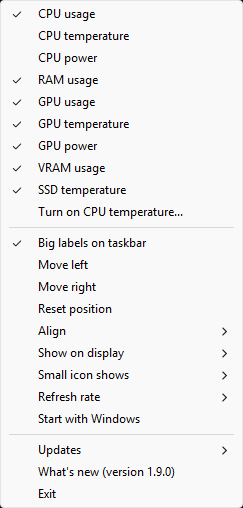
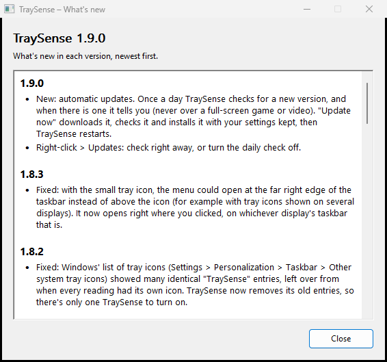

# TraySense

**Your PC's vital signs, right on the taskbar.** TraySense shows CPU, GPU, RAM, VRAM and SSD usage, temperatures and power next to the clock. You don't need to open anything or keep a window around.

It's small and light: one ~160 KB program written in plain C. It only redraws when a number changes, and it stops checking while the screen is off.

### [⬇ Download TraySense-Setup.exe](https://github.com/Fakem1d/Traysense/releases/latest/download/TraySense-Setup.exe)

Works on Windows 10 and Windows 11 (64-bit).

---

## What it shows

| Reading | Works with |
|---|---|
| CPU usage | Every PC |
| CPU temperature | Intel Core and AMD Ryzen processors |
| CPU power (watts) | Intel Core and AMD Ryzen processors |
| RAM usage | Every PC |
| GPU usage | Every graphics card (NVIDIA, AMD, Intel) |
| GPU temperature | Dedicated graphics cards |
| GPU power (watts) | NVIDIA graphics cards |
| VRAM usage | Every graphics card |
| SSD temperature | The drive Windows is installed on |

Turn any reading on or off from the menu.

## Features

- **Big labels on the taskbar.** They fit between your app buttons and the tray, never cover anything, and switch to a smaller layout when space runs short.
- **Or one small tray icon.** It shows the reading you pick, and hovering it lists all of them.
- **Any display.** Show the labels on your main monitor or any other one. Align them left, center or right, and nudge them into place.
- **Automatic updates.** TraySense checks once a day and tells you when a new version is out, but never over a full-screen game or video. One click updates it, with your settings kept.
- **Patch notes** open after every update, so you know what changed.
- **Starts with Windows** if you want it to.
- **Left-click** the labels to open Task Manager. **Right-click** for settings.

## Install

1. Download **[TraySense-Setup.exe](https://github.com/Fakem1d/Traysense/releases/latest/download/TraySense-Setup.exe)** from the [latest release](https://github.com/Fakem1d/Traysense/releases/latest).
2. Open it. If Windows shows **"Windows protected your PC"**, click **More info**, then **Run anyway**. This happens because TraySense isn't signed with a paid certificate; it's not a virus warning.
3. Pick where to install it and whether you want a desktop shortcut and start with Windows, then click **Install**.
4. TraySense starts right away. Right-click it to choose what it shows.

CPU temperature and CPU power need a small, signed, open-source driver called [PawnIO](https://github.com/namazso/PawnIO.Setup) (the same one LibreHardwareMonitor uses). The installer includes it, so those readings work right after installing.

## How to use it

Right-click the labels or the tray icon to open the menu:

| Menu item | What it does |
|---|---|
| CPU usage … SSD temperature | Turn each reading on or off |
| Big labels on taskbar | Switch between taskbar labels and a single tray icon |
| Move left / Move right / Reset position | Nudge the labels |
| Align | Put the labels on the left, center or right of the free space |
| Show on display | Show the labels on another monitor |
| Small icon shows | Pick which reading the tray icon shows |
| Refresh rate | How often readings update: 1, 2 or 5 seconds (5 uses the least power) |
| Start with Windows | Start TraySense when you sign in |
| Updates | Check for a new version now, or turn the daily check off |
| What's new | Patch notes for every version |

**Can't see the tray icon?** Windows 11 hides new tray icons. Go to **Settings > Personalization > Taskbar > Other system tray icons** and turn **TraySense** on. TraySense tells you when this happens and can open that page for you.

**Lost the menu?** Open TraySense again from the Start menu or desktop shortcut, and the menu opens.

## Updates

TraySense checks this page for a new release once a day. When there's one, it asks you:

**Update now** downloads the new installer. It checks the file against the checksum GitHub lists for it, then installs it with your settings kept. After that, TraySense restarts and shows what's new:

You can also check right away, or turn the daily check off, from **right-click > Updates**.

## Uninstall

Go to **Settings > Apps > Installed apps**, find **TraySense**, and click **Uninstall**. This removes everything: the program, its shortcuts, its startup entry, its settings and, if you choose, the PawnIO driver.

## Privacy

TraySense doesn't collect or send any data about you or your PC. The only time it goes online is the daily update check, which asks GitHub for the latest version number of this project. You can turn that off in **right-click > Updates**.

## Security and open source

All of the code is in [`src`](src). Every release is built by GitHub from that code, in public, and comes with a checksum and a build attestation you can check. [SECURITY.md](SECURITY.md) shows how, explains what TraySense does as administrator, and how to report a problem. [THIRD_PARTY.md](THIRD_PARTY.md) lists the outside parts it uses.

To build it yourself, run `sh build.sh` in [w64devkit](https://github.com/skeeto/w64devkit).

## Credits

- Based on [TraySense by DMTWEAKS](https://github.com/DMTWEAKS/traysense) (MIT License).
- CPU sensors are read through [PawnIO](https://github.com/namazso/PawnIO.Setup) by namazso and its [modules](https://github.com/namazso/PawnIO.Modules) (LGPL-2.1).

## License

MIT. See [LICENSE](LICENSE).
