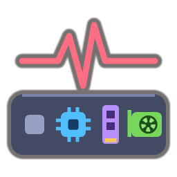
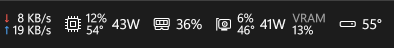
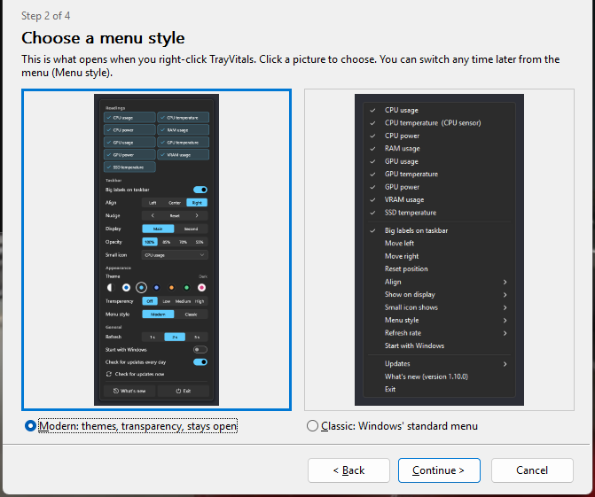
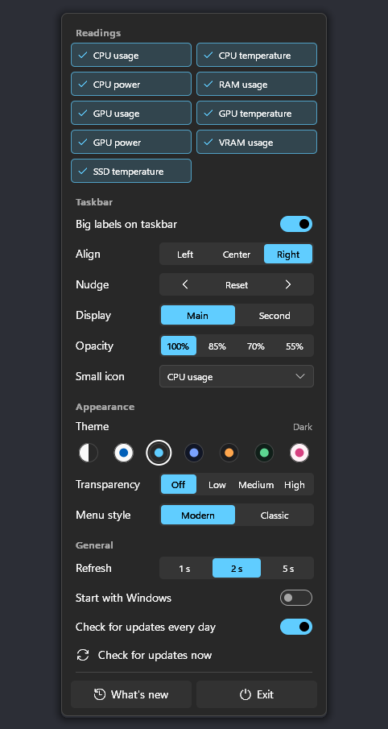
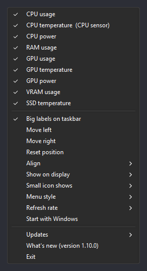
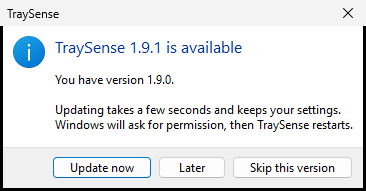

#  TrayVitals

[](https://github.com/Fakem1d/TrayVitals/releases/latest)
[](https://github.com/Fakem1d/TrayVitals/releases)

**Your PC's vital signs, right on the taskbar.** TrayVitals shows CPU, GPU, RAM, VRAM and SSD usage, temperatures and power next to the clock. You don't need to open anything or keep a window around.



It's small and light: one program of about 260 KB, written in plain C. It only redraws when a number changes, and it stops checking while the screen is off.

### [⬇ Download TrayVitals-Setup.exe](https://github.com/Fakem1d/TrayVitals/releases/latest/download/TrayVitals-Setup.exe)

Works on Windows 10 and Windows 11 (64-bit).

> **TrayVitals was called TraySense** before version 1.10.0. It started as a fork of [TraySense by DMTWEAKS](https://github.com/DMTWEAKS/traysense) and now has its own name, so the two aren't mixed up. If you have TraySense 1.9.0 from this repo, it updates itself to TrayVitals and keeps your settings.

---

## What it shows

| Reading | Works with |
|---|---|
| CPU usage | Every PC |
| CPU temperature | Intel Core and AMD Ryzen processors |
| CPU power (watts) | Intel Core and AMD Ryzen processors |
| RAM usage | Every PC |
| GPU usage | Every graphics card (NVIDIA, AMD, Intel) |
| GPU temperature | Dedicated graphics cards |
| GPU power (watts) | NVIDIA and AMD Radeon graphics cards (Radeon support is new in 1.10.0) |
| VRAM usage | Every graphics card |
| SSD temperature | The drive Windows is installed on |

Turn any reading on or off from the menu.

## Features

- **Big labels on the taskbar.** They fit between your app buttons and the tray, never cover anything, and switch to a smaller layout when space runs short.
- **Or one small tray icon.** It shows the reading you pick, and hovering it lists all of them.
- **Any display.** Show the labels on your main monitor or any other one. Align them left, center or right, and nudge them into place.
- **Your look.** Seven themes (Follow Windows, Light, Dark, Midnight, Graphite, Forest, Sakura), see-through menus and popups, and adjustable label opacity.
- **Two menu styles.** TrayVitals' own modern menu, or Windows' standard one. Pick one when installing and switch any time.
- **Automatic updates.** TrayVitals checks once a day and tells you when a new version is out, but never over a full-screen game or video. One click updates it, with your settings kept.
- **Patch notes** open after every update, so you know what changed.
- **Starts with Windows** if you want it to.
- **Left-click** the labels to open Task Manager. **Right-click** for settings.

## Install

1. Download **[TrayVitals-Setup.exe](https://github.com/Fakem1d/TrayVitals/releases/latest/download/TrayVitals-Setup.exe)** from the [latest release](https://github.com/Fakem1d/TrayVitals/releases/latest).
2. Open it. If Windows shows **"Windows protected your PC"**, click **More info**, then **Run anyway**. This happens because TrayVitals isn't signed with a paid certificate; it's not a virus warning.
3. Setup walks you through four short steps: **Welcome**, **Menu style**, **Options** (desktop shortcut, start with Windows, CPU temperature support) and **Install** (where to put it). Use **Back** to change anything before you click **Install**.
4. TrayVitals starts right away. Right-click it to choose what it shows.



CPU temperature and CPU power need a small, signed, open-source driver called [PawnIO](https://github.com/namazso/PawnIO.Setup) (the same one LibreHardwareMonitor uses). The installer includes it, so those readings work right after installing.

## How to use it

Right-click the labels or the tray icon to open the menu. There are two styles; switch between them with **Menu style** in either menu.

| Modern | Classic |
|---|---|
|  |  |
| TrayVitals' own menu. It stays open while you change settings, so you see each change right away. Follows the theme and transparency. | Windows' standard menu, in light or dark. Keeps it simple: themes and transparency are set from the modern menu. |

| Setting | What it does |
|---|---|
| Readings | Turn each reading on or off. An amber dot means TrayVitals can't find that sensor on your PC. |
| Big labels on taskbar | Switch between taskbar labels and a single tray icon |
| Align / Nudge | Put the labels on the left, center or right of the free space, and move them a little |
| Display | Show the labels on another monitor |
| Opacity | How see-through the taskbar labels are |
| Small icon | Which reading the tray icon shows |
| Theme | Follow Windows, or pick one of six themes |
| Transparency | How see-through the menu and popups are (the What's new window always stays solid) |
| Menu style | Modern or Classic |
| Refresh | How often readings update: 1, 2 or 5 seconds (5 uses the least power) |
| Start with Windows | Start TrayVitals when you sign in |
| Updates | Check for a new version now, or turn the daily check off |
| What's new | Patch notes for every version |

**Can't see the tray icon?** Windows 11 hides new tray icons. Go to **Settings > Personalization > Taskbar > Other system tray icons** and turn **TrayVitals** on. TrayVitals tells you when this happens and can open that page for you.

**Lost the menu?** Open TrayVitals again from the Start menu or desktop shortcut, and the menu opens.

## Updates

TrayVitals checks this page for a new release once a day. When there's one, it asks you:



**Update now** downloads the new installer. It checks the file against the checksum GitHub lists for it, then installs it with your settings kept. After that, TrayVitals restarts and shows what's new:


You can also check right away, or turn the daily check off, from the menu (**Updates**).

## Report a problem or suggest an idea

Something not working, or a reading that looks wrong? [Open an issue](https://github.com/Fakem1d/TrayVitals/issues/new/choose) and pick **Report a problem** or **Suggest an idea**. A short form asks for the details that help most, like your TrayVitals version, Windows version and graphics card. Especially welcome: how **GPU power on AMD Radeon** cards looks on yours, since that's new.

Security problems: please report them privately instead, see [SECURITY.md](SECURITY.md).

## Uninstall

Go to **Settings > Apps > Installed apps**, find **TrayVitals**, and click **Uninstall**. This removes everything: the program, its shortcuts, its startup entry, its settings and, if you choose, the PawnIO driver.

## Privacy

TrayVitals doesn't collect or send any data about you or your PC. The only time it goes online is the daily update check, which asks GitHub for the latest version number of this project. You can turn that off from the menu.

## Build it yourself

All of TrayVitals is in this repo. Anyone can build it, change it and share their own version for free, as long as it's not sold or used commercially (see [License](#license)).

**You need:** [w64devkit](https://github.com/skeeto/w64devkit) on Windows (a free, portable compiler; nothing to install), or MinGW-w64 on Linux (`sudo apt install gcc-mingw-w64-x86-64`).

1. Download this repo (**Code > Download ZIP**) and unzip it, or `git clone` it.
2. Open `w64devkit.exe`, go to the folder (`cd C:/path/to/TrayVitals`) and run:
   ```
   sh build.sh
   ```
3. You get `TrayVitals-Setup.exe` in the same folder (and `src/TrayVitals/TrayVitals.exe`, the program on its own).

`build.sh` downloads the official PawnIO installer the first time and stops if its SHA-256 doesn't match (see [THIRD_PARTY.md](THIRD_PARTY.md)).

### Build options

Pass them in `EXTRA_CFLAGS`:

| Option | What it does |
|---|---|
| `-DTS_UPDATE_REPO=L""` | No update checks at all |
| `-DTS_UPDATE_REPO=L"you/your-fork"` | Check your own GitHub repo for updates (releases tagged like `v1.10.0`, with `TrayVitals-Setup.exe` attached) |
| `-DTS_MENU_MODERN=0` | Windows' standard menu by default (people can still switch) |

For example:

```
EXTRA_CFLAGS='-DTS_UPDATE_REPO=L"you/your-fork"' sh build.sh
```

### Trying a change without touching your installed TrayVitals

`src/TrayVitals/preview.c` builds a preview copy that runs next to the installed one, with its own settings, and never touches startup, updates or Windows' tray settings. Its menu has **Preview the popups**, to see every popup once. How to build it is at the top of that file.

### What's where

Everything TrayVitals is made from is in this repo, including the hidden files whose names start with a dot. Every file can be read and changed.

| File | What it is |
|---|---|
| `src/version.h` | Version number and the update repo. Change the version here and add a section at the top of `patchnotes.h`. |
| `src/TrayVitals/trayvitals.c` | The program: sensors, taskbar labels, tray icon, menu commands, updates |
| `src/TrayVitals/ui.h` | The look: themes, transparency, the modern menu, popups and the What's new window |
| `src/TrayVitals/patchnotes.h` | The text of the What's new window |
| `src/TrayVitals/trayvitals.rc`, `trayvitals.manifest` | The program's icon, version info and Windows settings (DPI, visual style) |
| `src/TrayVitals/preview.c` | Builds a preview copy for trying changes (see above) |
| `src/TrayVitals/pawnio/` | The signed PawnIO modules that read CPU temperature (see [THIRD_PARTY.md](THIRD_PARTY.md)) |
| `src/TrayVitals/trayvitals.ico` | The icon. `tools/make-icon.ps1` draws it; change the script and run it to make your own. |
| `src/installer/setup.c`, `setup.rc`, `setup.h`, `setup.manifest` | The installer and uninstaller (the four setup pages) |
| `src/installer/images/` | The menu pictures shown in setup |
| `tools/make-icon.ps1` | Draws the icon (PowerShell, no extra software needed) |
| `build.sh` | Builds everything (see [Build it yourself](#build-it-yourself)) |
| `.github/workflows/build.yml` | How GitHub builds each release, step by step. In a fork, change it freely, for example to drop the extra `TraySense-Setup.exe` copy. |
| `.gitignore` | Which files git leaves out: only build results and the downloaded PawnIO installer. Each line is explained in the file. |
| `screenshots/` | The pictures in this README |
| `LICENSE`, `LICENSE-NONCOMMERCIAL.md`, `SECURITY.md`, `THIRD_PARTY.md` | License, security notes and third-party parts |
### Making a release (for this repo)

Set the version in `src/version.h`, add the patch notes, push, then publish a GitHub release tagged with the same version (like `v1.10.0`). GitHub builds the installer from that code and attaches it with a checksum and a build attestation. See [SECURITY.md](SECURITY.md).

## Security and open source

Every release is built by GitHub from the code in this repo, in public, and comes with a checksum and a build attestation you can check. [SECURITY.md](SECURITY.md) shows how, explains what TrayVitals does as administrator, and how to report a problem. [THIRD_PARTY.md](THIRD_PARTY.md) lists the outside parts it uses.

## Credits

- Based on [TraySense by DMTWEAKS](https://github.com/DMTWEAKS/traysense) (MIT License).
- CPU sensors are read through [PawnIO](https://github.com/namazso/PawnIO.Setup) by namazso and its [modules](https://github.com/namazso/PawnIO.Modules) (LGPL-2.1).
- AMD Radeon GPU power uses the AMD Display Library, following AMD's [ADL SDK](https://github.com/GPUOpen-LibrariesAndSDKs/display-library) (MIT).

## License

TrayVitals is free for any noncommercial use: use it, change it, build it and share it.
**Selling it, or using it in a commercial product or service, isn't allowed** without written permission.

- The original TraySense by DMTWEAKS stays under its **MIT License** (the main license).
- Everything added or changed in this fork, from version 1.10.0 on, is under the **[PolyForm Noncommercial License 1.0.0](LICENSE-NONCOMMERCIAL.md)**.

See [LICENSE](LICENSE) for the details. Versions before 1.10.0 were released under MIT alone.
